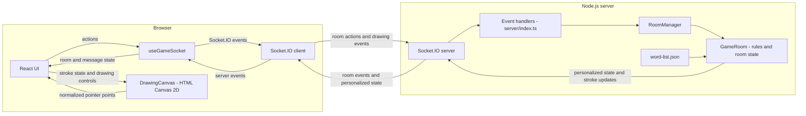
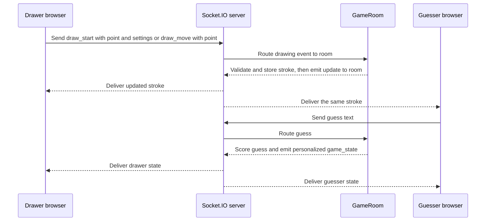

# Live Deployed on
https://scrribleclub.onrender.com/


# Scribble Club

A real-time drawing and guessing game built with React, TypeScript, Express, and Socket.IO.

## Run locally

Requirements: Node.js 20.19+ and npm.

```bash
npm install
npm run dev
```

Open the Vite URL printed in the terminal (normally `http://localhost:5173`). The Vite development server proxies API and Socket.IO traffic to the game server on port `3001`.

To run the production build locally:

```bash
npm run build
npm start
```

Open `http://localhost:3001`. The Express server serves the built client and handles Socket.IO connections on the same origin.

## Tech stack

- **Frontend:** React 19 and TypeScript, bundled with Vite 7.
- **Backend:** Node.js and Express 5.
- **Real-time multiplayer:** Socket.IO 4 for room events, drawing synchronization, and chat.
- **Styling:** CSS.
- **Testing:** Vitest 5, including a two-client Socket.IO integration test.
- **Crawler metadata:** `public/robots.txt` and `public/llms.txt` are served from the site root.

## How WebSockets, the canvas, and game logic work

### Architecture overview



### Room connection and state

The React UI is split into pages and components under `src/components/`. `src/hooks/useGameSocket.ts` creates the Socket.IO client, exposes game actions, and stores the latest room state and messages. The client sends events such as `create_room`, `join_room`, `start_game`, `word_chosen`, and `guess`.

Express serves the client and HTTP endpoints, while Socket.IO attaches to the same HTTP server for real-time events. `server/index.ts` validates event payloads, associates each socket with a room, and routes actions to the corresponding `GameRoom`. `RoomManager` tracks active rooms; each `GameRoom` owns that room's players, settings, phase, timer, scores, messages, and strokes.

The server broadcasts room state to each player individually so it can keep secrets private: only the drawer receives word choices, and only the drawer receives the full word while drawing in normal mode. Other players receive the masked hint. Public room listings are broadcast separately.

### Drawing synchronization

`src/components/game/DrawingCanvas.tsx` handles pointer input and draws strokes using the browser's HTML Canvas 2D API. It converts each pointer position into normalized coordinates from `0` to `1`, so the same stroke fits clients with different canvas sizes.

At the start of a stroke, the client sends `draw_start` with its first point and the stroke's color, size, and tool. Each subsequent pointer-move event sends one `draw_move` point—not one message per pixel. The server verifies that the sender is the current drawer, validates the point and drawing options, stores it, and broadcasts the stroke update to the room. Undo and clear operations update the server's stroke list and send the new canvas state.

Clients keep the shared stroke list in React state and redraw it on their canvases. The canvas uses a logical `1100 × 620` coordinate space and resizes its backing store for the displayed size and device pixel ratio; the network sends stroke data, not canvas images.



### Game flow and scoring

`GameRoom` is the authority for game phases and rules. It checks host-only lobby actions and drawer-only word and canvas actions, advances turns, runs the round and hint timers, and handles guesses. Guesses are trimmed, whitespace-normalized, and case-insensitive, but must match the complete word. The first correct guess ends the round: the guesser earns 100–500 points based on remaining time, and the drawer earns 50 points when the word is solved. Each player gets one turn per configured round.

The word prompts live in `server/game/word-list.json`; add or edit entries there. Shared room, player, message, and drawing types plus the drawing-color palette live in `shared/protocol.ts`.

## Technology choices

- **React and TypeScript** keep the interface component-based; shared game-data types keep room, player, point, and stroke shapes consistent across client and server.
- **Vite** provides the fast development server and production bundling; the game UI is lazy-loaded so it is not part of the initial home-page chunk.
- **Socket.IO** provides event-based communication, room broadcasts, and reconnection behavior without implementing those mechanisms directly on raw WebSockets. It uses a WebSocket transport when available and can fall back to polling.
- **Node.js and Express** host the game server, health/public-room endpoints, and production client. Socket.IO shares the same HTTP server.
- **HTML Canvas 2D** is suited to interactive drawing. Sending normalized points and stroke metadata keeps synchronization independent of viewport size and avoids transmitting full images.
- **In-memory room state** keeps the game simple to run without a database. Active rooms are lost when the server restarts, and this setup is intended for a single server process.
- **JSON for the prompt list** keeps editable game content separate from room logic.
- **Vitest** runs the server tests, including a two-client Socket.IO integration test for room state, drawing, and scoring.

## Main Socket.IO events

| Event | Direction | Purpose |
| --- | --- | --- |
| `create_room`, `join_room`, `leave_room` | Client → server | Create, join, or leave a room |
| `player_ready`, `update_settings`, `start_game` | Client → server | Lobby actions; host-only actions are checked by the server |
| `word_chosen`, `guess`, `chat` | Client → server | Choose a prompt, submit a guess, or send chat |
| `draw_start`, `draw_move`, `draw_end`, `draw_undo`, `canvas_clear` | Client → server | Drawer-only canvas operations |
| `game_state`, `room_joined`, `public_rooms` | Server → client | Personalized game state and room listings |
| `draw_start`, `draw_move`, `draw_end`, `canvas_state` | Server → room | Synchronized drawing updates |
| `chat_message`, `guess_result`, `server_error` | Server → client/room | Chat, correct-guess result, or a rejected action |

Game state is personalized: word options are sent only to the drawer, and during play the secret word is not included in guessers' state. Public rooms are discoverable; private rooms are omitted from the public list and can be joined using their room code/invite link.

## Tests

```bash
npm test
npm run test:watch
```

Vitest runs the server test suite; use `npm test` for a single run or `npm run test:watch` while developing. The tests cover guess normalization, settings bounds, secret-word privacy, real-time stroke delivery, and scoring through two connected game clients.
